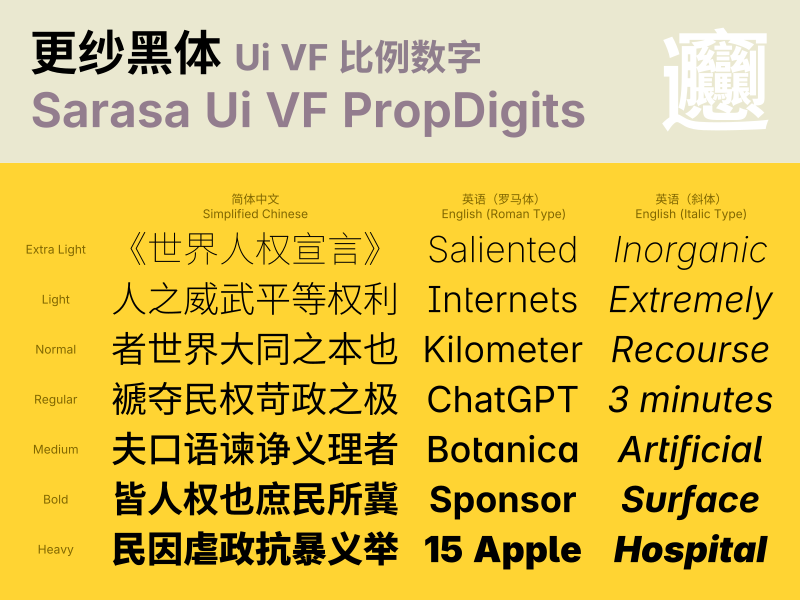

# 更纱黑体 Ui PropDigits

<p align="center">
  
</p>

## 为什么要制作它？

曾几何时，我试图使用[更纱黑体（Sarasa Gothic）](https://github.com/be5invis/sarasa-gothic)作为 Android 手机的默认字体（因为个人更喜欢 [SF Pro](https://developer.apple.com/cn/fonts/) / [Inter](https://rsms.me/inter/) 而非 [Roboto](https://fonts.google.com/specimen/Roboto)），但由于修改软件只支持一个字体，我需要一个可变字体。但可惜的是，[原版更纱并不支持](https://github.com/be5invis/Sarasa-Gothic/issues/314)，我只好自己动手，用 Codex 中的 GPT-5.5 制作了本字体的最初的可变版本；静态版本以及比例宽数字则是源于我对其成为 [Unigram](https://github.com/unigramdev/unigram) / Windows 默认字体的需要。

随后，上游版本号与 GPT 都不断更新——v1.0.40 起，我换用了 GPT-5.6 Sol；v1.0.40.4 起，我换用了 GPT-6 Astra——过度审计、黑话、防御性编程就是这个时期出现的问题。后来，自 v1.0.43 起，我转投了 Claude 的怀抱（把原先用的 GPT Pro 5x 换成了 Plus，因此额度不够用 Astra 了），改用了 Opus 5.5 来干活。不得不说，Claude 确实比较聪明，并能理解我的意图，同时重做了屎山般的审计代码。最后，也就到了现在，在 Fable 5.2 (Max Ultracode) 审计结果的刺激之下，我重新回头审视了 Vibe Coding 的这段经历，决心彻底地重构了本项目，并让 Gemini 4 Neon 来实操这一过程。不得不说，Gemini 确实更会「说人话」（或许应该让它来当 Sub-Agent 的工头），就是 Antigravity 不太好用，上下文给我限制在了 512K。

## 简介

Sarasa Ui PropDigits 是面向中西文混排的更纱黑体 Ui 衍生字体（当前版本 **v1.0.43.4**，基于上游 Sarasa Gothic 1.0.43 的设计规则，直接由 Source Han Sans VF、Inter VF 与 Shanggu Sans VF 合成单一可变字体真相源，再由可变字体实例化并生成全部静态字体）。

与原版更纱黑体 Ui 的主要区别：

- **默认比例数字**：37 个数字、空格、标点与运算符码位默认采用 Inter 比例宽度，并保留等宽 `tnum` 与斜线零 `tnum + zero`。
- **完整可变字体 + 6 档静态字重**：提供 6 地区共 12 个可变 TTF（`wght` 200–900）与 144 个静态 TTF（含原版未提供的 `Heavy` 900），VF 与同字重静态逐字形一致。
- **标点与排版增强**：注入 `chws`/`vchw` 标点挤压；保留完整 `cmap` format 14（UVS/IVS）、Inter 上下文保护规则（如 `x<-1`、`2026/11/19`）、古韩文 L+V+T 合成保护、西里尔与希腊默认语言 `tnum`/`mark`/`mkmk` 及 `bopo` 标点路由；CL 采用尚古黑体 1.028 完整字集并修正非全宽汉字与误标间距字。
- **独立静态 Hinting**：静态 hinted 字体采用 `ttfautohint`（西文/数字）叠加独立精简 `Chlorophytum`（CJK/假名/韩文，含 `Heavy` 独立配置），在 FreeType 9–128 px 严格执行下全字形零报错，并与 unhinted 静态共享完全相同的轮廓与 OpenType 布局。

## 地区、字重与下载包

字体菜单中的家族名缩写为 **Sarasa Ui PD \<地区\>**，可变系列为 **Sarasa Ui VF PD \<地区\>**（本地化家族名同样带 `PD`）；文件名与发布包名保留 `PropDigits`。全系列共 6 地区、12 个 VF、72 个 hinted 静态、72 个 unhinted 静态，合 156 个 TTF / 21 个发布 ZIP（每地区 3 包 + 3 个全地区合集包，不提供 TTC/SuperTTC）。

<!-- BEGIN SPEC:regions -->
<!-- END SPEC:regions -->

<!-- BEGIN SPEC:weights -->
<!-- END SPEC:weights -->

以 `SC` 为例，单地区下载包为：

| 包名 | 内容 |
| --- | --- |
| `Sarasa-Ui-VF-PropDigits-SC-TTF-1.0.43.4.zip` | 正体、斜体 2 个可变 TTF + 根目录许可证与说明 |
| `SarasaUiPropDigitsSC-TTF-1.0.43.4.zip` | 6 字重正斜体共 12 个 hinted 静态 TTF + 根目录许可证与说明 |
| `SarasaUiPropDigitsSC-TTF-Unhinted-1.0.43.4.zip` | 6 字重正斜体共 12 个 unhinted 静态 TTF + 根目录许可证与说明 |

全地区合集包为 `Sarasa-Ui-VF-PropDigits-TTF-1.0.43.4.zip`、`SarasaUiPropDigits-TTF-1.0.43.4.zip`、`SarasaUiPropDigits-TTF-Unhinted-1.0.43.4.zip`（静态合集包中仅在根目录放一份 `LICENSE.txt`、`NOTICE.md`、`README.md`，各地区子目录只含 12 个 TTF）。

只支持单字体文件且支持可变 TTF 的工具可选用对应地区的正体 VF（斜体另有文件）。字体成品不入 git 仓库，请从 [GitHub Releases](https://github.com/Mr-Drinking/Sarasa-Ui-PropDigits/releases) 下载。

## 构建与检查

需要 Python 3.13+（按 [requirements.lock](requirements.lock) 哈希锁定安装至单个 venv）及网络下载固定上游归档；构建 hinted 静态时自动准备固定 Node.js 与 `hint/` 中的精简 Chlorophytum 环境。

```powershell
# 核验环境与锁文件
python -E -s -X utf8 -m sarasa_pd env

# 完整构建（VF -> unhinted 静态 -> hinted 静态）
python -E -s -X utf8 -m sarasa_pd build --stage all --out fonts

# 按阶段单独构建或只做局部地区/字重
python -E -s -X utf8 -m sarasa_pd build --stage vf --regions SC,CL --out .build-cache/runs/dev
python -E -s -X utf8 -m sarasa_pd build --stage unhinted --regions SC --out .build-cache/runs/dev
python -E -s -X utf8 -m sarasa_pd build --stage hinted --regions SC --weights Regular --out .build-cache/runs/dev

# 产品规则、OTS 与 FreeType 严格检查（日常快检 --ft-mode fast，发版全量 --ft-mode full）
python -E -s -X utf8 -m sarasa_pd check --stage all --root fonts --ft-mode fast
python -E -s -X utf8 -m sarasa_pd check --stage all --root fonts --ft-mode full

# 与上游或前版对照（输出对比表与明细 JSON）
python -E -s -X utf8 -m sarasa_pd compare --baseline upstream --cand-root fonts --out .build-cache/compare/upstream

# 打包全部 21 个确定性 ZIP 并执行只读核验
python -E -s -X utf8 -m sarasa_pd package --root fonts --dist dist/v1.0.43.4

# 运行单元测试
python -E -s -X utf8 -m unittest discover -s tests
```

## 上游来源与许可证

<!-- BEGIN SPEC:sources -->
<!-- END SPEC:sources -->

字体按 SIL Open Font License 1.1 分发，完整许可证与版权声明见 [LICENSE](LICENSE) 与 [NOTICE.md](NOTICE.md)。

## 详细文档

- [规格](docs/规格.md)：地区来源、字重与轴映射、比例数字与 `tnum`、标点与语言路由、竖排、`chws` 与度量
- [与上游的差异](docs/与上游的差异.md)：有意差异、跟随 VF 单真相源带来的差异统计、继承上游的行为与已知限制
- [构建与 Hint](docs/构建.md)：单一真相源管线、固定来源、依赖环境、A1 静态 Hinting 方案与缓存机制
- [验证与发布.md](docs/验证与发布.md)：产品规则检查、OTS/FreeType 扫描、对照报告、Windows/FreeType 样张与发布流程
