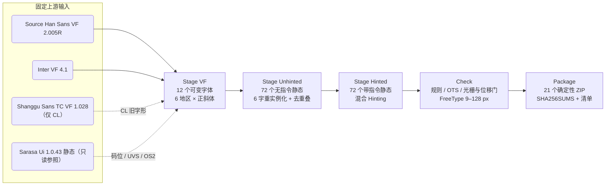

# 构建与 Hinting 架构

本项目采用 **VF 单真相源** 架构，全部构建、检查、对照、样张与打包逻辑位于 [sarasa_pd/](../sarasa_pd/) 包内，规格集中维护在 [sarasa_pd/spec.toml](../sarasa_pd/spec.toml)。

## 1. 管线总览



- **VF 阶段**（`sarasa_pd/vf/`）：按 `VF_STAGES` 显式顺序执行：
  1. `load_sources`：加载并校验固定 VF 来源与上游 Sarasa Ui 1.0.43 只读参照（读取 `cmap` 边界），载入并烘焙 Inter；
  2. `prepare_base`：子集化 Source Han（保留 `cmap` format 14 与 UVS 闭包）→ 限轴至内部 `wght`（CL 核对轴空间后叠加尚古）→ 映射到公开 `wght` 轴与 `avar` → 烘焙 `pwid` 并规整符号与韩文宽度 → 斜体物化 IUP 后剪切 `9.4°`；
  3. `merge_inter_glyphs`：将 Inter `gvar` 重映射到公开轴（单次取整），并入 Inter 字形与 `.notdef`；
  4. `merge_layout`：裁剪宽度特性与 `locl`，导入 Inter GDEF/GSUB/GPOS 布局并按上游恢复空 GSUB 特性记录；
  5. `apply_punctuation`：构建破折号/省略号路由（含 `bopo` 及竖排 3em 原生字形切分三段 1em 无缝字形）并做首轮死 lookup 与不可达字形清理；
  6. `apply_fixes_and_metadata`：执行 CL 汉字全宽与 GDEF 修复、OS/2 bit 57 与上游同风格 `OS/2`（含 `ulUnicodeRange1–4`、`xAvgCharWidth`、斜体上下标偏移）及 `head.lowestRecPPEM` 同步、命名、STAT、垂直度量、MVAR、光栅元数据（`head.flags = 3`）与确定性 `head`；
  7. `apply_chws`：通过 `chws_tool` 注入 `chws`/`vchw` 标点挤压；
  8. `finalize_and_save`：去 Mac 名、清未引用名、布局收尾（含西里尔/希腊共享 DFLT 与 `PairSet` 排序）、二次 GDEF 与不可达字形清理、重算 `head` 边界与 `lsb == xMin`、合并同支撑 `gvar` 元组与斜体容差 0 IUP 重优化、由 `gvar` 重建 `HVAR`、重算 `OS/2.usMaxContext`、写入确定性 `head.modified`（同时移除 `BASE`/`DSIG`）。
- **Unhinted 静态阶段**（`sarasa_pd/static/instance.py`）：由 `fontTools.varLib.instancer` 在 6 个命名字重（200/300/400/600/700/900）实例化后，用 `fontTools.ttLib.removeOverlaps` + 锁定 `skia-pathops`（`ignoreErrors=False`，绝不静默跳过报错或重叠复合字形）对全部静态实例严格去除重叠轮廓（与上游静态一致；VF 保持原始可变重叠轮廓不动）。同一地区与字重的正体、斜体联动构建：去重叠前先配对正斜体 9.4° 同源简单字形（强断言全部编码 CJK/假名/韩文 100% 配对），正体去重叠并整数化后再按 9.4°（以 `em/3` 为中心、`y` 坐标逐点不变）剪切写入斜体，斜体未配对字形（Inter 真斜体、竖排 3em 分段与复合字形）单独严格去重叠；随后清理可变表、写入按字重/正斜体精确对齐的静态 `OS/2`（含 `xAvgCharWidth` 与 `ulUnicodeRange1–4`）、命名、`post` format 3、smart dropout `gasp`/`prep` 与 `head.flags = 3`。
- **Hinted 静态阶段**（`sarasa_pd/static/hint.py`）：对 unhinted 静态施加混合 hinting（见第 3 节），收尾时置位 `head.flags` bit 3（`15`，强制 ppem 取整）并保真 `OS/2` 与 `head.lowestRecPPEM = 3`。

## 2. 固定来源与依赖环境

### 固定上游归档

下载归档均校验固定 SHA-256，解压前严格检查路径穿越；`zip` 与 `7z` 归档拒绝符号链接，Node.js 的 `tar.xz` 归档仅允许指向归档内部目标的相对符号链接：

<!-- BEGIN SPEC:sources -->
| 来源 | 用途 | 归档文件 | SHA-256（前 16 位） |
| --- | --- | --- | --- |
| `source_han_vf` | CJK 可变字体基底 | `SourceHanSans-VF-2.005R.zip` | `e5944ea725387840…` |
| `inter` | 西文与数字可变字体 | `Inter-4.1.zip` | `9883fdd4a49d4fb6…` |
| `shanggu_vf` | CL 传统旧字形覆盖 | `ShangguSansVF_TTFs-1.028.7z` | `31b207a05332196f…` |
| `sarasa_ui_cl` | CL 只读参照（默认按需下载） | `SarasaUiCL-TTF-Unhinted-1.0.43.7z` | `30dbf87fe1a975c5…` |
| `sarasa_ui_sc` | SC 只读参照（默认按需下载） | `SarasaUiSC-TTF-Unhinted-1.0.43.7z` | `1b55231dc382ac78…` |
| `sarasa_ui_tc` | TC 只读参照（默认按需下载） | `SarasaUiTC-TTF-Unhinted-1.0.43.7z` | `10c34d46b38e18ca…` |
| `sarasa_ui_hc` | HC 只读参照（默认按需下载） | `SarasaUiHC-TTF-Unhinted-1.0.43.7z` | `abd648ea42ff1537…` |
| `sarasa_ui_j` | J 只读参照（默认按需下载） | `SarasaUiJ-TTF-Unhinted-1.0.43.7z` | `ac0594f969748d34…` |
| `sarasa_ui_k` | K 只读参照（默认按需下载） | `SarasaUiK-TTF-Unhinted-1.0.43.7z` | `e0c90a24f8a4d323…` |
| `sarasa_ui_unhinted_all` | 全地区只读参照（本地已有时优先复用） | `SarasaUi-TTF-Unhinted-1.0.43.7z` | `c17173820f91ecd7…` |
| `sarasa_ui_hinted_all` | 全地区 hinted 参照（hint 位移门对照，各地区亦可按需单独下载） | `SarasaUi-TTF-1.0.43.7z` | `980a4fc33c95f1a6…` |
<!-- END SPEC:sources -->

### 单一 Python 环境

全部构建、检查、对照、样张与打包共用单一虚拟环境（Python 3.13+），由 [requirements.lock](../requirements.lock) 钉住全部直接与传递依赖的版本及哈希，不再需要 `afdko`、`FontBakery` 或 `numpy`：

```powershell
python -m venv .build-cache/venv
.build-cache/venv/Scripts/python.exe -m pip install --require-hashes -r requirements.lock
.build-cache/venv/Scripts/python.exe -E -s -X utf8 -m sarasa_pd env
```

`sarasa_pd env` 校验锁文件哈希完整、已安装包与锁文件一致且无站外同名模块遮蔽。

## 3. 混合静态 Hinting 与持久缓存

静态 hinted 字体不再走旧版 Sarasa 原生 pass1/kanji/hangul/pass2 管线，而是直接基于 VF 实例化的 unhinted 静态执行两段叠加：

1. **西文与数字（`ttfautohint`）**：使用锁定的 `ttfautohint-py`（或环境变量 `TTFAUTOHINT` 指定的可执行文件），选项 `--fallback-script=none --fallback-scaling`，并通过 `--control-file` 按 GID 将 `U+0360`、`U+22EF` 设为 `none dflt @ <gid>` 保持不缩放；CJK/假名/韩文字形因无西文脚本分类而原样保留未加指令。
2. **CJK / 假名 / 韩文（独立精简 `Chlorophytum`）**：
   - 使用固定 Node.js `v26.12.1` 与 [hint/package.json](../hint/package.json)、[hint/package-lock.json](../hint/package-lock.json) 安装独立精简的 `@chlorophytum/cli` 至 `.build-cache/hint-env`（不依赖整个 Sarasa 源码树）。
   - 6 个字重各有独立配置文件 [hint/hcfg/](../hint/hcfg/)，其中 900 字重的 `Heavy.json` 沿用与 `Bold.json` 相同的 `CANONICAL_STEM_WIDTH = 0.097`（实测若提高至 `0.118` 会令 `maxStemWidth` 扩至 `177 unit`，导致密集汉字如 `厵`/`窐`/`窠` 在 40–48 px 误并相邻横画而拉断 `5.9–7.2 px`）。
   - **跨地区增量持久缓存与冷热确定性**：每个字重维护一份按轮廓几何哈希索引的共享缓存 `.build-cache/hint-cache/cache-<Weight>.gz`。每次 `chlorophytum hint` 在临时副本上运行后再按键排序增量合并回共享缓存；产出的 `.hint.gz` 在交由 `chlorophytum instruct` 前统一按 `#<gid>` 升序规范化重排，消除多线程冷缓存与热缓存因遍历顺序不同造成的 `fpgm` 函数编号差异，保证冷热缓存产出逐字节一致。
   - **去重叠后先正体后斜切，零秒安全复用正体 CJK 指令**：静态实例在 hint 前已严格去除重叠轮廓（消除 Chlorophytum 面对重叠笔画片段误判横画边界导致的形变），且斜体 CJK/假名/韩文及未编码同源字形均由去重叠后的正体字形按 9.4° 直接斜切生成（`y' == y` 严格一致）。重映射阶段零容差强断言全部编码 CJK/假名/韩文（含韩文字母与音节）轮廓数、端点、`on-curve` 标志、逐点 `y` 坐标与 9.4° 斜切完全一致，按 `#gid`、`cmap`、`cmap` format 14（UVS）与 `(轮廓数, 端点, on-curve, 精确 y 坐标序列) + 9.4° 斜切校验` 精确映射全部含未编码 GSUB/UVS 在内的 Chlorophytum 字形，不放宽任何断言，默认严禁静默跳过任何条目，直接交由 `chlorophytum instruct` 注入指令。
   - **补足 `cvt` 消除 FreeType 执行预算中止**：`finalize_hinted_ttf` 将 `cvt ` 表补零扩充至至少 `16384` 项（纯零在 ZIP 中几乎零体积开销，同时把 FreeType 的 DoS 指令步数预算提升至安全裕量以上），使全部字形在 9–128 px 严格扫描下 0 报错且已有字号位图零变化。

## 4. 命令行速查

所有命令均通过 `python -E -s -X utf8 -m sarasa_pd <子命令>` 调用：

| 子命令 | 用途 | 常用参数 |
| --- | --- | --- |
| `env` | 核验 Python 隔离环境与锁文件 | `--lock PATH` |
| `build` | 构建字体 | `--stage {vf,unhinted,hinted,all}`、`--regions SC,CL`、`--weights Regular,Heavy`、`--styles upright,italic`、`--subset {full,smoke}`、`--jobs N`、`--out DIR` |
| `check` | 产品规则、OTS、FreeType 9–128 px 与一致性检查 | `--stage {vf,unhinted,hinted,all}`、`--root DIR`、`--regions`、`--weights`、`--styles`、`--subset {full,smoke}`、`--ft-mode {fast,full}`、`--jobs N`、`--skip-ots` |
| `compare` | 对比候选字体与上游或前版（或单对文件） | `--baseline {upstream,project}`、`--cand-root DIR`、`--cand-version VER`、`--ref-root DIR`、`--ref-version VER`、`--hinted`、`--cand-file`/`--ref-file`/`--cand-wght`/`--ref-wght`、`--no-vf`、`--no-static`、`--regions`、`--weights`、`--styles`、`--jobs N`、`--out DIR` |
| `samples` | 生成 FreeType 6 地区与本机 Windows GDI/DirectWrite 对比样张 | `--cand-root DIR`、`--ref-root DIR`、`--ref-version VER`、`--regions`、`--weights`、`--styles`、`--out DIR`、`--windows-only` |
| `package` | 校验全量检查标记，生成 21 个确定性 ZIP、`SHA256SUMS.txt`、`release-manifest.json` 并只读核验 | `--root DIR`、`--dist DIR`、`--skip-check-gate` |
| `docs` | 按 `spec.toml` 同步 README 与 `docs/` 中的规格表格 | `--check` |

网络较慢时可通过标准代理环境变量 `HTTP_PROXY` / `HTTPS_PROXY` 下载上游归档。设置 `SOURCE_DATE_EPOCH` 可覆写构建时间戳。
